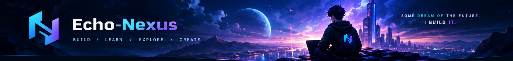

<!--
Echo-Nexus GitHub Profile README
Personalize the links and remove any tools you do not actively use.
-->

# `Echo-Nexus`

### AI/ML Explorer · Full-Stack Developer · Builder

  
  
  

  <em>Learn deeply. Build consistently. Make technology useful.</em>

---

## ◈ About

I'm a developer focused on growing across **Artificial Intelligence / Machine Learning** and **full-stack software engineering**. I learn by building practical projects, understanding the fundamentals, and improving through iteration.

- 🧠 Exploring AI/ML, intelligent applications, and the math behind them
- 🛠️ Building web applications with real users and real workflows in mind
- 🌐 Learning backend architecture, APIs, databases, and real-time systems
- 📈 Improving my problem-solving, algorithms, and software design skills
- 🤝 Open to learning with other builders and contributing to meaningful projects

> `Current mindset:` make it work → understand why → make it reliable → make it excellent.

## ⚡ Tech I Work With

  

  My stack is evolving; this list reflects technologies I work with or am actively learning.

## 🚀 Featured Projects

<table>
  <tr>
    <td width="50%" valign="top">
      <h3>🍞 BreadBox</h3>
      
<strong>Restaurant management & ordering</strong>

      A full-stack restaurant platform focused on menu management, ordering workflows, and a maintainable backend.
      

        
        
        
      

      <a href="https://github.com/Echo-Nexus/breadbox">View repository →</a>
    </td>
    <td width="50%" valign="top">
      <h3>🛒 SwiftBasket</h3>
      
<strong>E-commerce application</strong>

      A learning-focused e-commerce project covering product browsing, authentication, and admin workflows.
      

        
        
        
      

      <a href="https://github.com/Echo-Nexus?tab=repositories">Explore repositories →</a>
    </td>
  </tr>
  <tr>
    <td width="50%" valign="top">
      <h3>🧠 AI Study Workspace</h3>
      
<strong>AI-powered learning concept</strong>

      A study workspace concept combining AI chat, notes, PDF workflows, quizzes, flashcards, and planning.
      

        
        
      

      <em>In planning / development — link the repository when it is public.</em>
    </td>
    <td width="50%" valign="top">
      <h3>💬 Real-Time Chat Lab</h3>
      
<strong>Learning real-time communication</strong>

      A small project for understanding user discovery, one-to-one messaging, WebSockets, and Socket.IO fundamentals.
      

        
        
        
      

      <a href="https://github.com/Echo-Nexus?tab=repositories">Explore repositories →</a>
    </td>
  </tr>
</table>

## 📊 GitHub Overview

  
  

  

> Stats cards are served by third-party projects, so they can occasionally be rate-limited or unavailable. Language charts describe code in repositories, not necessarily overall skill level.

## 🐍 Contribution Trail

  <picture>
    <source media="(prefers-color-scheme: dark)" srcset="https://raw.githubusercontent.com/Echo-Nexus/Echo-Nexus/output/github-contribution-grid-snake-dark.svg" />
    <source media="(prefers-color-scheme: light)" srcset="https://raw.githubusercontent.com/Echo-Nexus/Echo-Nexus/output/github-contribution-grid-snake.svg" />
    
  </picture>

## 🌌 What I'm Exploring

- **AI / ML:** foundations, model APIs, and useful AI-powered product experiences
- **Full-stack engineering:** secure APIs, database design, authentication, and deployment
- **Real-time systems:** WebSockets, Socket.IO, and WebRTC fundamentals
- **Computer science:** algorithms, data structures, mathematics, and clean code

## 🤝 Connect

<!-- Add verified links below when ready:

-->

  

**Let's build something meaningful.**

<code>Curiosity → Code → Creation → Impact</code>

